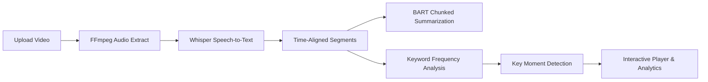

# ClipMind AI 🎬🧠

**ClipMind AI** is a video intelligence and summarization platform built with **FastAPI**, **OpenAI Whisper**, and **HuggingFace BART**. It extracts spoken dialogue, generates structured short and detailed summaries, detects high-density key moments with keyword clustering, synchronizes real-time interactive transcripts, provides role-based access control (RBAC), and serves an analytics dashboard.

---

## 🌟 Key Features

- **Automated Video Processing**: Audio extraction (16 kHz mono, denoised), automated speech-to-text with Whisper, and chunked BART summarization.
- **Key-Moment Indexing**: Keyword-density scoring across 30-second sliding windows to pinpoint the top non-overlapping highlight moments.
- **Interactive Synchronized Transcript**: Live karaoke-style segment highlighting synchronized with HTML5 video playback, real-time segment search, and one-click jump-to-timestamp.
- **Multi-Format Export**: Export summaries, transcripts, WebVTT (`.vtt`), SubRip (`.srt`) subtitle tracks, and raw JSON.
- **Native Video Streaming with Byte-Range Seeking**: HTTP 206 Partial Content range requests for instant scrubbing across videos of any size.
- **Role-Based Access Control (RBAC)**: Four roles (`admin`, `creator`, `educator`, `learner`) with audit logging. The first registered user automatically becomes the Super Admin.
- **Bookmarks & Notes**: Save custom study notes at exact player timestamps and jump directly to them.
- **Analytics & Vocabulary Intelligence**: Real-time KPI cards, top topic frequency charts, and per-video view metrics.
- **Admin Console**: Live user role management, background job queue monitoring with retry capability, and security audit logs.
- **Resilient Fallback Mode**: Gracefully handles offline development and environments without ffmpeg/CUDA GPUs without crashing.

---

## 🏗️ Architecture & Pipeline



1. **Upload**: Accepts `.mp4`, `.mov`, `.avi`, `.webm`, `.mkv`, `.mp3`, `.wav`, `.m4a` up to configured size limit (`MAX_UPLOAD_MB`).
2. **Audio Extraction**: Extracts 16 kHz mono WAV audio with optional `afftdn` denoise filter via FFmpeg.
3. **Transcription**: Whisper extracts words with second-level timestamps (`start`, `end`, `text`).
4. **Summarization**: BART generates both an executive summary (~80 words) and an expandable detailed summary (~250 words).
5. **Key Moments**: Calculates density of key vocabulary across sliding windows to highlight peak concepts.
6. **Delivery**: FastAPI serves video stream with HTTP 206 byte-ranges, token authentication, and a modern single-page web app.

---

## 🚀 Quickstart

### Option 1: Run with Docker Compose (Recommended for Production)

Make sure Docker is installed and running, then execute:

```bash
docker compose up --build
```

- Web UI & API: [http://localhost:8000](http://localhost:8000)
- Interactive API Docs (Swagger): [http://localhost:8000/docs](http://localhost:8000/docs)
- Alternative Redoc: [http://localhost:8000/redoc](http://localhost:8000/redoc)

---

### Option 2: Local Python Setup (Development)

1. **Prerequisites**: Python 3.10+ and [FFmpeg](https://ffmpeg.org/download.html) (optional for local fallback mode).
2. **Create and activate a virtual environment**:
   ```bash
   python -m venv .venv
   # Windows:
   .venv\Scripts\activate
   # macOS / Linux:
   source .venv/bin/activate
   ```
3. **Install dependencies**:
   ```bash
   pip install -r backend/requirements.txt
   ```
4. **Run the server**:
   ```bash
   uvicorn backend.app.main:app --host 0.0.0.0 --port 8000 --reload
   ```
5. Open [http://localhost:8000](http://localhost:8000) in your browser.

---

## 🧪 Running Automated Tests

A comprehensive test suite covering authentication, RBAC, video upload, processing, transcripts, bookmarks, analytics, and admin endpoints is included.

Run tests with pytest:

```bash
pytest tests -v
```

---

## ⚙️ Environment Variables

Copy `.env.example` to `.env` or pass variables to your container:

| Variable | Default | Description |
|---|---|---|
| `DATABASE_URL` | `sqlite:///./clipmind.db` | Database connection string (PostgreSQL or SQLite) |
| `SECRET_KEY` | `dev-secret-key-clipmind-change-in-prod` | Secret key for JWT signing (use 32+ bytes) |
| `UPLOAD_DIR` | `uploads` | Directory on disk to store uploaded videos |
| `MAX_UPLOAD_MB` | `500` | Maximum allowable upload file size in megabytes |
| `WHISPER_MODEL` | `base` | Whisper model size (`tiny`, `base`, `small`, `medium`, `large`) |
| `SUM_MODEL` | `facebook/bart-large-cnn` | Hugging Face summarization model |

---

## 🛡️ Role-Based Access Control (RBAC)

| Capability | Learner | Creator | Educator | Admin |
|---|:---:|:---:|:---:|:---:|
| Browse shared videos | ✅ | ✅ | ✅ | ✅ |
| Interactive player & transcript | ✅ | ✅ | ✅ | ✅ |
| Create bookmarks & study notes | ✅ | ✅ | ✅ | ✅ |
| Download transcripts & subtitles | ✅ | ✅ | ✅ | ✅ |
| Upload videos | ❌ | ✅ | ✅ | ✅ |
| Edit transcript & recalculate | ❌ | ✅ | ✅ | ✅ |
| Toggle public/private sharing | ❌ | ✅ | ✅ | ✅ |
| Reprocess AI pipeline | ❌ | ✅ | ✅ | ✅ |
| View analytics dashboard | ❌ | ✅ | ✅ | ✅ |
| Manage users & change roles | ❌ | ❌ | ❌ | ✅ |
| Monitor job queue & retry | ❌ | ❌ | ❌ | ✅ |
| View audit trail logs | ❌ | ❌ | ❌ | ✅ |

*Note: The first registered account automatically receives the `admin` role.*

---

## 📡 API Reference Overview

### Authentication
- `POST /auth/register` - Create new user account.
- `POST /auth/login` - Authenticate and obtain JWT access token.
- `GET /me` - Retrieve current user profile.

### Videos
- `POST /videos` - Upload video or audio file.
- `GET /videos` - List accessible videos (supports `mine=true` and `search=...`).
- `GET /videos/{vid}` - Get full video details, transcript, and key moments.
- `GET /videos/{vid}/stream` - Stream video with HTTP 206 byte-range seeking.
- `PUT /videos/{vid}/transcript` - Edit transcript and trigger summary recalculation.
- `POST /videos/{vid}/share` - Toggle public/private video sharing.
- `POST /videos/{vid}/reprocess` - Re-run Whisper and BART pipeline.
- `DELETE /videos/{vid}` - Delete video, physical file, and associated bookmarks.
- `GET /videos/{vid}/search?q=...` - Search transcript segments for keywords.
- `GET /videos/{vid}/download?kind=...` - Export as `transcript`, `summary`, `vtt`, `srt`, or `json`.

### Bookmarks & Notes
- `POST /bookmarks` - Bookmark timestamp with optional note.
- `GET /bookmarks` - List user's saved bookmarks with video titles.
- `DELETE /bookmarks/{bid}` - Delete a bookmark.

### Analytics
- `GET /analytics` - Aggregate KPIs, keyword frequencies, and per-video metrics.

### Admin
- `GET /admin/users` - List all registered users and video counts.
- `PATCH /admin/users/{uid}` - Change a user's role.
- `DELETE /admin/users/{uid}` - Delete a user account.
- `GET /admin/jobs` - View status of background video processing tasks.
- `POST /admin/jobs/{vid}/retry` - Retry a failed or queued job.
- `GET /admin/audit` - View system audit trail.

---

## ☁️ Production Deployment

### AWS (ECS & ECR)
1. Build and push image to AWS ECR:
   ```bash
   aws ecr get-login-password | docker login --username AWS --password-stdin <ECR_URL>
   docker build -t clipmind -f backend/Dockerfile .
   docker tag clipmind:latest <ECR_URL>:latest
   docker push <ECR_URL>:latest
   ```
2. Deploy ECS Task with managed AWS RDS PostgreSQL and an attached EFS/S3 volume for uploads. Set `DATABASE_URL` and `SECRET_KEY`.

### Azure (App Service & ACR)
1. Push to Azure Container Registry:
   ```bash
   az acr login --name <REGISTRY_NAME>
   docker build -t <REGISTRY_NAME>.azurecr.io/clipmind:latest -f backend/Dockerfile .
   docker push <REGISTRY_NAME>.azurecr.io/clipmind:latest
   ```
2. Create Web App for Containers pointing to Azure Database for PostgreSQL.
